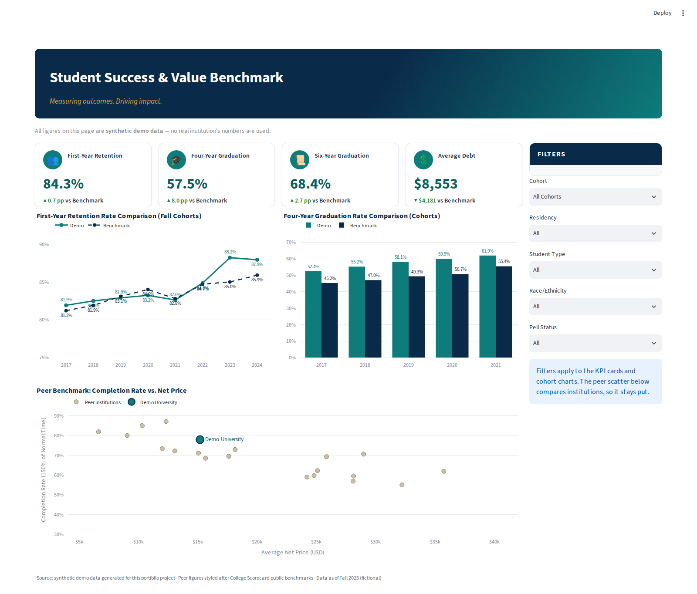
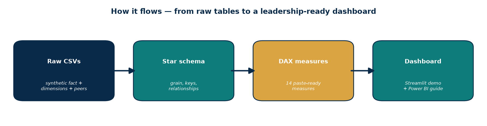
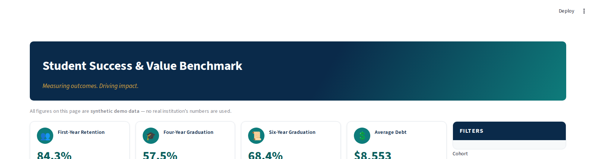
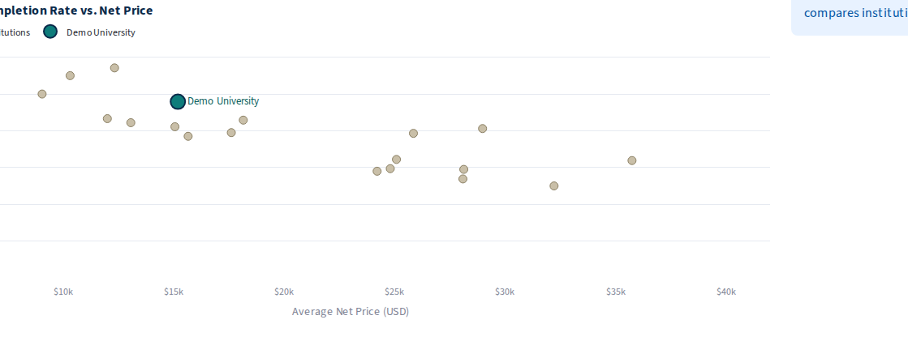

# Student Success & Value Benchmark


> **All data here is synthetic demo data.** I generated it with a Python script — it's shaped like the retention/graduation reporting I do in institutional research, but every number is fictional. Nothing here comes from any real university.

## The business question

*"Which student segments are falling behind on retention and graduation — and where do we actually beat or lag our peers?"*

That's the question enrollment and provost leadership ask every fall. This dashboard answers it: headline outcomes, benchmarked against a system average, sliceable by cohort, residency, student type, race/ethnicity, and Pell status — so the conversation moves from "how are we doing?" to "who needs attention, and where are we winning?"



## What the numbers say

- **We graduate students well above our peers.** Four-year graduation runs 57.5% — **+8.0 percentage points** above the system average. Six-year is 68.4% (+2.7 pp). First-year retention is 84.3% (+0.7 pp).
- **The value story is real:** average debt per graduate is $8,553 — **$4,181 below** the system average — while completion runs above it. Upper-left quadrant of the peer scatter, which is exactly where you want to be in a recruitment conversation.
- **The equity gap is the actionable finding:** Pell recipients retain at 81.2% vs 85.7% for non-Pell — a **4.5-point gap**. That's the segment to investigate and intervene on.
- **Out-of-state students trail in-state by 3.0 points** on retention (81.8% vs 84.8%) — worth a look at onboarding and support for that population.
- **The trend is moving the right way:** retention climbed from 81.9% (2017 cohort) to 87.9% (2024), pulling ahead of the system (81.2% → 85.9%) over the same window.

### Headline metrics vs benchmark

| Metric | Demo University | System benchmark | Delta |
| --- | ---: | ---: | ---: |
| First-year retention | 84.3% | 83.6% | +0.7 pp |
| Four-year graduation | 57.5% | 49.5% | +8.0 pp |
| Six-year graduation | 68.4% | 65.6% | +2.7 pp |
| Average debt | $8,553 | $12,734 | −$4,181 |

### Where the gaps are (first-year retention by segment)

| Segment | Retention |
| --- | ---: |
| Non-Pell | 85.7% |
| Pell recipients | 81.2% |
| In-state | 84.8% |
| Out-of-state | 81.8% |

## Why I built it this way



- **Star schema, not a flat file.** Fact table at cohort × segment grain plus conformed dimensions — the standard shape for BI work. One model feeds every visual, and every slicer cuts the numbers consistently. Diagram: `model/star-schema.png`
- **DAX measures, not calculated columns.** Measures evaluate under filter context, so every filter combination recomputes correctly. 14 measures in `dax/measures.dax`, paste-ready for Power BI Desktop.
- **Filter-based year-over-year instead of `PREVIOUSYEAR`.** The year column is an integer, not a date — `PREVIOUSYEAR` would error in Desktop. Small judgment call, documented in the code, and the kind of thing that breaks a dashboard if you get it wrong.

```dax
Retention Rate YoY (pp) =
-- No date table: cohort_year is an integer, so the prior year is
-- picked up with a filter instead of PREVIOUSYEAR (which would error).
VAR _this_year = MAX ( dim_cohort[cohort_year] )
VAR _curr = [Retention Rate]
VAR _prev =
    CALCULATE (
        [Retention Rate],
        REMOVEFILTERS ( dim_cohort ),
        dim_cohort[cohort_year] = _this_year - 1
    )
RETURN
    ( _curr - _prev ) * 100
```
- **Graduation measures aggregate observable cohorts only.** Four-year rates are blank for 2022+ cohorts, six-year for 2020+ — just like real IR data. Averaging in unobservable cohorts would silently deflate the rates.
- **Benchmarks in percentage points.** That's the unit leadership actually compares in — not ratios, not indexes.

## Honest limitations

- **Synthetic data** — the patterns illustrate the method, not a real institution. Treat findings as a demo of analytical thinking, not facts about any university.
- **No causal claims.** The Pell retention gap is a correlation worth investigating, not proof of cause. A real follow-up would control for preparation, enrollment intensity, and finances.
- Six-year graduation is only observable for the 2017–2019 cohorts; the "system average" benchmark and the peer set are fictional (styled after College Scorecard).

## What's inside

- `data/` — the generator plus all CSVs (448-row fact table, 5 dimensions, benchmark + peer tables, data dictionary)
- `model/star-schema.png` — the data model diagram
- `dax/measures.dax` — 14 real, working DAX measures
- `dashboard/app.py` — interactive Streamlit demo recreating the dashboard (KPI cards, retention trend, graduation bars, peer scatter, working filter panel)

## Run the demo

```bash
cd student-success-benchmark
pip install -r requirements.txt
streamlit run dashboard/app.py
```

Then open the URL it prints (usually http://localhost:8501). Try the filters — everything recomputes. `python data/generate_data.py` regenerates the data (seeded, reproducible).

## Rebuild this in Power BI Desktop in 15 minutes

1. **Get Data → the CSVs** in `data/` (five `dim_*.csv`, `fact_student_outcomes.csv`, `peer_benchmark.csv`, `peer_institutions.csv`).
2. **Model view → draw the relationships** exactly like `model/star-schema.png`: one-to-many, single direction, from each dimension to the fact on its key; `peer_benchmark` joins on `cohort_year`.
3. **Paste `dax/measures.dax`** into new measures (Modeling → New measure, one at a time).
4. **Build the visuals:** four cards (`Retention Rate`, `4-Yr Graduation Rate`, `6-Yr Graduation Rate`, `Avg Debt`, each with its vs-benchmark measure); line chart of retention vs benchmark by `cohort_year`; clustered bars of 4-yr graduation vs benchmark; scatter of `avg_net_price` × `completion_rate` with institution as detail; slicers for cohort, residency, student type, race/ethnicity, Pell status.
5. Format the cards navy/teal/gold and you're done.

## What this demonstrates

- Scoping a vague leadership question into a modeled, benchmarked, decision-ready dashboard
- Star-schema modeling with proper grain, keys, and slowly-observable measures
- DAX with blank handling, `DIVIDE`, filter-context year-over-year logic, and `SUMX` weighting
- Benchmarking every headline metric in percentage points — the unit stakeholders use
- Shipping the same model as an interactive web demo when Power BI isn't handy

## Screenshots





## License

MIT — see [LICENSE](LICENSE).
